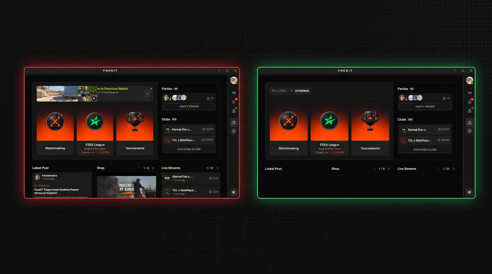

### faceit-ads-blocker

Removes the ads and the premium banner from the FACEIT desktop client by patching electron. Ad network requests are blocked as well.



## Requirements

- Windows 10 or 11
- Node.js 22.12 or newer

## Setup

```bash
git clone https://github.com/antilagg/faceit-ads-blocker.git
cd faceit-ads-blocker
npm install
```

## Usage

```bash
node index.js
```

Not affiliated with FACEIT, i been using it without any problems for two weeks. use it at your own risk. "
